# claude-annotate

Claude writes you a long answer. You read it in a browser instead of a terminal,
click the one paragraph you disagree with, and type why. Claude rewrites *that
block* — not the whole answer, not a fresh reply appended below it.

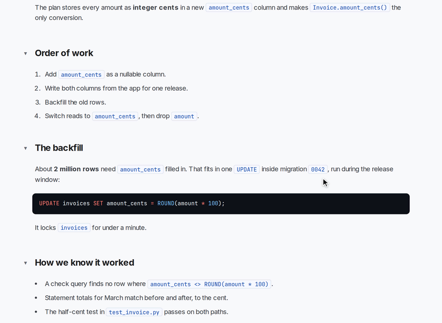

## What is in it

Seventeen skills and one plugin, counted from `skills/` and `fleet/`. Every row
links to its section, and every row with a clip shows that clip there.

| Skill | What it does | Shown |
|---|---|---|
| [`annotate`](#use) | A long answer in a browser; comment on one part, only that part is rewritten | clip |
| [`annotate` part kinds](#not-just-prose) | Decisions, mockups, diagrams, tables, code and more, each commentable | clips |
| [`deck`](#decks) | Comment on a line of your HTML deck; Claude edits that line in the file | clip |
| [`slides`](#decks) | Build and audit HTML decks; the audit names what overflows | clip |
| [`talk`](#talk-and-stage) | Talk a problem through; boards light up as each word is said | clip |
| [`stage`](#talk-and-stage) | One live page of boards that reloads as files change | clip |
| [`spotlight`](#spotlight) | Explain a screen part by part, the rest dimmed | clip |
| [`canvas`](#canvas) | Many screenshots on one canvas, with comments pinned on them | clip |
| [`dataflow`](#structure) | A feature's path through the code; hover a field to light its route | clip |
| [`specimen`](#structure) | One Java object filled with real values, nulls marked | clip |
| [`app_map`](#structure) | A map of the whole application with the open file's part lit | clip |
| [`fleet`](#people-and-fleets) | Every session on every machine, one page; sessions message each other | clip |
| [`journey`](#people-and-fleets) | Pin comments on an app's screens and send them as one batch | clip |
| [`draw`](#people-and-fleets) | A drawing pad at a fixed link; Update sends the sketch to your session | clip |
| [`show-diff`](#ide) | Every changed file of a branch in one VS Code scroll; ask on a line | clip |
| [`ask_diff`](#ide) | Ask questions on a PR diff line in IntelliJ | clip |
| [`walkthrough`](#ide) | A codebase answer walked step by step in IntelliJ | clip |
| [`pr-diff`](#ide) | Open a PR's diff in the IntelliJ window that has its branch | text only: needs a GitHub sign-in and a real PR |
| [`annotate-doctor`](#how-it-works) | Check this machine can run everything, and install the daemon | text only: a utility |

Fifteen of the seventeen skills and `fleet` have a clip; `pr-diff` and
`annotate-doctor` are described in text. How each
clip was made, and how to record it again, is in [docs/SHOTLIST.md](docs/SHOTLIST.md).

## Requirements

- **`python3` on your `PATH`, version 3.9 or newer.** Standard library only —
  there is nothing to `pip install`.
- **`bash` and `curl`** (both ship with macOS and every mainstream Linux).
- **`/canvas` only:** building a canvas makes thumbnails with Pillow, which
  `uv run --with pillow tools/canvas.py build …` fetches for that one run.
- **macOS or Linux.** Windows is not supported.
- **`node`** — runs the ELK layout engine behind the flowchart layout
  switcher. Without it, `kind: "flowchart"` blocks still render, but fall
  back to the simpler grid layout and ship no layout control.
- `claude-ide-review` additionally needs an IDE half — the IntelliJ plugin for
  `/ask-diff` and `/walkthrough`, the VS Code extension for `/show-diff` — see
  below.

On a fresh Mac without the Xcode Command Line Tools there is no `python3` at
all; `xcode-select --install` or `brew install python` provides one. If
anything misbehaves after installing, run `/annotate-doctor` for a check of
your machine.

## Install

    /plugin marketplace add petmakris/claude-annotate

That registers the marketplace, which publishes three plugins. Install any of them:

    /plugin install claude-annotate      # comment on a long answer, build and review slide decks, draw a feature's
                                         # data flow, or see one Java object filled with real values
    /plugin install claude-ide-review    # ask questions on a PR diff line or walkthrough step in IntelliJ,
                                         # or open any diff in VS Code and ask on its lines (show-diff)
    /plugin install fleet                # join sessions into a fleet whose members message each other

`claude-ide-review` also needs the IDE half for whichever editor you use, each a
separate install:

- **IntelliJ**, for `/ask-diff` and `/walkthrough` — grab the `.zip` from
  [Releases](https://github.com/petmakris/claude-annotate/releases) and install
  it via **Settings → Plugins → ⚙ → Install Plugin from Disk…**
- **VS Code**, for `/show-diff` — the `petros-makris.petros-makris-vscode`
  extension, built from `vscode-plugin/` and installed with
  `vscode-plugin/install.sh --build` (it runs `build.sh`, then
  `code --install-extension` on the `.vsix` it produces).
  `/show-diff` drives nothing else.

Twelve skills — `annotate`, `ask_diff`, `canvas`, `dataflow`, `deck`, `draw`,
`journey`, `show-diff`, `specimen`, `stage`, `talk` and `walkthrough` — push to the same
**webcompanion daemon**, a standalone service installed separately from its own
repository (`pipx install webcompanion && webcompanion install-service`; see
[Related](#related)) — not something this repository runs. `show-diff` degrades
gracefully without it: diffs still open, only the per-line comment feature is
unavailable. `canvas` still builds its page without it; only the comments need it.
The others have no server of their own to fall back to (`dataflow`'s field view
is the one part of them that never needs it). `slides`, `spotlight` and `app_map`
never use the daemon, `annotate-doctor` only checks it, and `pr-diff` hands the PR
to the IntelliJ plugin and never talks to it. The `fleet` plugin
(`/plugin install fleet`) joins sessions so they can message each other.

## Which diff tool, when

Seven things in this setup can put a diff in front of you, and they used to be told apart
only by which one you happened to remember. They are told apart by two questions now:
which two commits, and can you type into the result.

The left endpoint is one shared ref. `@git pr-base --pin` writes a `pr-base` branch at the
commit your branch forked from, and it does not move when somebody else merges into
master. The IntelliJ base key resolves that same ref through `BaseBranchResolver`,
`cr -p` through `@git pr-base --sha`, and `show-diff` through the base `diffable`
reports. Re-pin after a rebase; nothing else moves it.

| Tool | Two commits | Where | Editable |
|------|-------------|-------|----------|
| `cr` | last commit, `N` back, a sha, `a..b`, `-w` worktree vs HEAD | terminal (diffnav), pipeable | no |
| `cr -p` | `pr-base` → worktree | terminal | no |
| ⌥D (IDE plugin) | this file's uncommitted change, or its last commit; press again to walk back, ⌘⌥D to step toward the working copy | IntelliJ, one file | **yes** |
| ⌥B (IDE plugin) | base branch → the live file, no picker | IntelliJ, one file | **yes** |
| ⌥H (IDE plugin) | HEAD → the live file | IntelliJ, one file | **yes** |
| `/show-diff` | any pair, another checkout, a colleague's branch | VS Code, one scroll | **yes** |
| `/ask-diff` | a PR diff snapshot | IntelliJ, threaded | no — it answers questions |

The keys are the plugin's Mac keymap (`ide-plugin/src/main/resources/META-INF/plugin.xml`);
⌘K in IntelliJ lists them all.

Your own in-progress branch belongs to the IntelliJ keys, because you are already in the
file and the right-hand pane is the file itself. `/show-diff` is for what those keys
cannot reach: another checkout, several at once, a stacked branch's parent, an
`origin/<branch>` this clone has never fetched.

`/ask-diff` was called `/interactive-review` until 2026-09-02, and `cr` fronted
`@git review` until the same day. Neither of them judges a PR — one answers questions
about a diff, the other reads one — so neither kept the word "review".

## Use

Ask for something long — a migration plan, a critique of a design, a list of
findings, then push it into the view:

    /annotate

Your browser opens. Every part is commentable. Select a few words and press `c`,
or click a part, and type what should change. Comments collect into a round;
Submit round sends them together. Claude replaces only the parts you commented
on, the rest of the page does not move or reload, and a bar says how many parts
changed and which ones you asked for.

That first `/annotate` also arms the session: from then on every substantive
answer goes to the browser instead of the terminal, until you say "respond in
terminal". Nothing routes there on its own before you ask.

When Claude reaches a real fork it asks with a **decisions** part: one
recommended option, the others behind *See other ways*. Pick one, change your
mind, and the pick travels with the round.

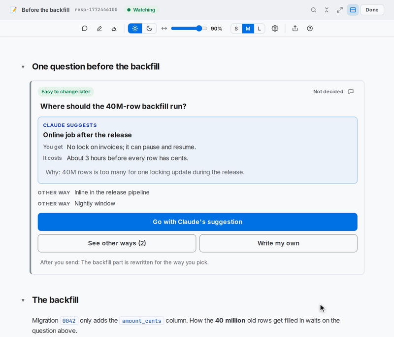

## Decks

`/deck <path to a deck .html>` opens a presentation the same way, except the
document is a file you already own. Every slide renders as itself, in order, at
the size it will be shown. Click any line — a title, a paragraph, a bullet —
say what should change, and Claude edits that line in the file.

The deck is never rewritten wholesale. A comment resolves to a line range, not
to a search string, so an edit is one line in `git diff` and the entities,
attribute case and formatting everywhere else survive untouched.

    /deck ~/decks/2026-quarterly-review

A folder resolves to the `.html` inside it with the same name.

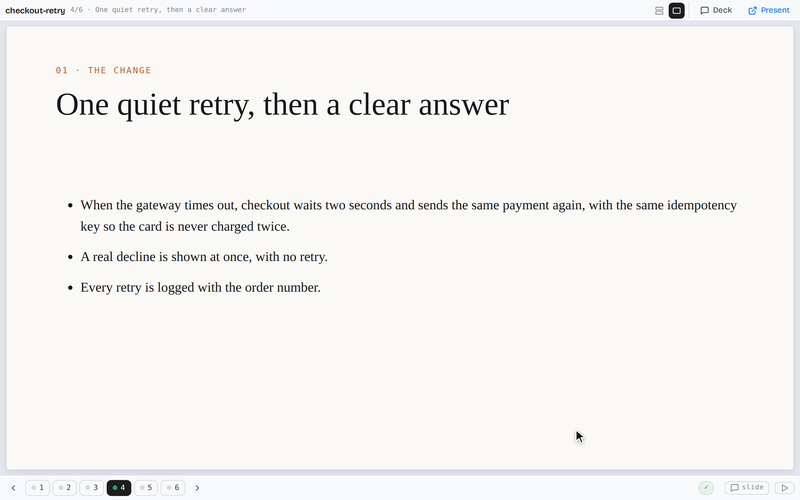

`/slides` builds and extends these decks, and its layout audit measures every
slide in a real browser. When a point runs off a slide, the audit names the
element and by how many pixels; the slide is split, never shrunk, and the audit
runs clean.

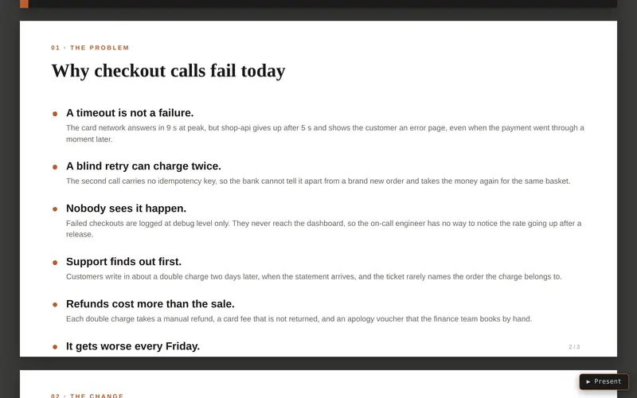

## Not just prose

Claude splits each answer into parts and picks a kind per part — a decision
becomes clickable options, a protocol becomes a sequence diagram, a UI idea
becomes a working mock, a list of work becomes a jobs list with what is done,
running and blocked. Every kind is
commentable, and Claude rewrites the one you flag.

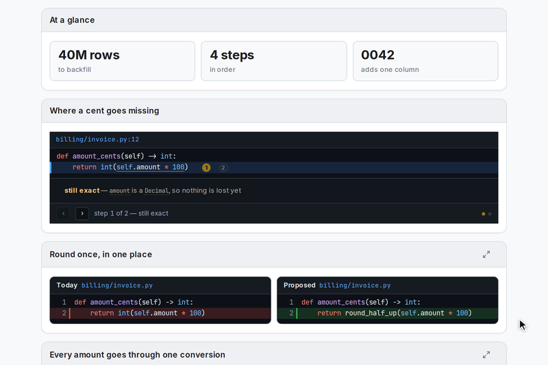

### Sequence diagrams

Rendered by the plugin's own SVG layout engine — actors, phases, notes, and
three arrow types. Comment on the diagram and Claude redraws the flow.

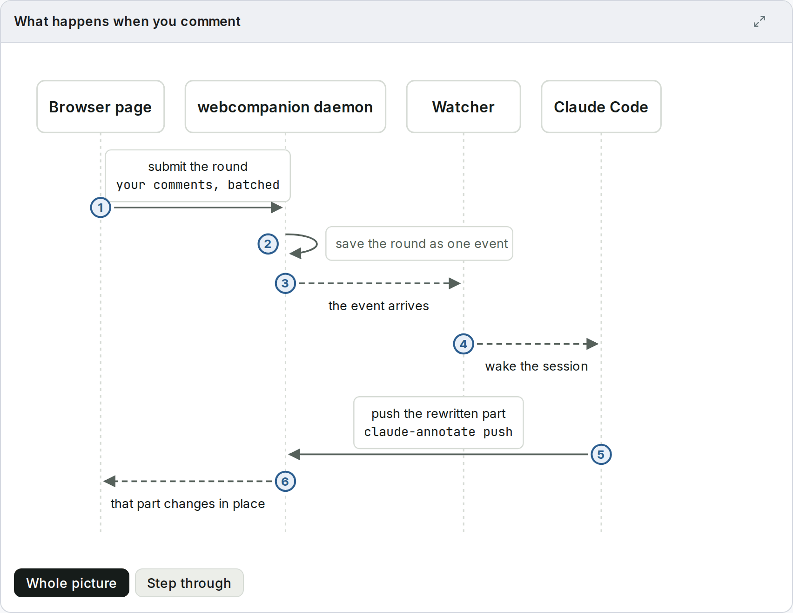

### Flowcharts

Structured nodes with roles that drive shape and color — entry, decision,
success, error — plus `Class:line` references that jump to the source. Claude
can also emit the flow as restricted Python (`spec.source`), so you get a
*line* to comment on when you want the logic changed.

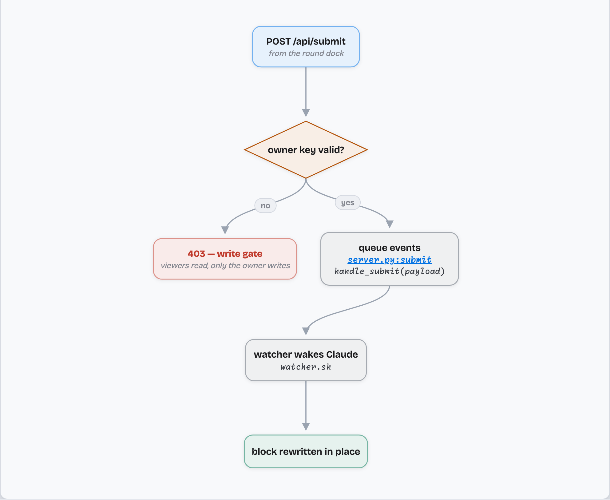

### Interactive mockups

Real HTML with working `<style>` and `<script>`, sandboxed in an iframe — the
toggles toggle. Tag regions with `data-annotate-id` and comments can target
the sidebar or one settings row instead of the whole mock.

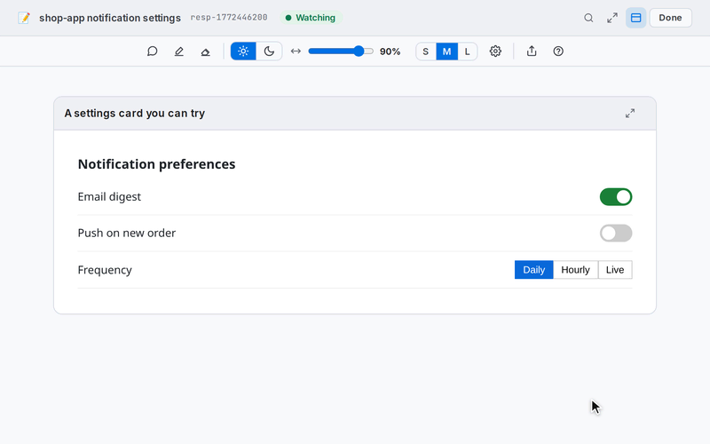

### The reading machinery around them

- **Rounds** — comments batch into one explicit submit, so Claude wakes once
  per review pass, not once per thought.
- **Four verdicts per part** — comment, *delete*, *keep as written*, or
  *compact* (fold its point into what stays). A whole review, not just margin
  notes.
- **What changed** — a rewritten part carries a *what changed* chip that
  shows the diff against the text you commented on.
- **Voice dictation** — dictate comments straight into the comment box
  (works on `localhost`, where the browser grants a secure context).
- **Fuzzy search** — filter a long answer down to the blocks that mention
  the thing you're looking for.
- **Paste images** — screenshots paste into comments and travel to Claude
  with the round.
- **Persistent workspaces** — documents live in the webcompanion daemon's
  storage until you delete them; close the tab, come back next month, the
  comment history is still there. The daemon's landing page lists your
  sessions, `/annotate resume <slug>` reattaches Claude to one, and
  `webcompanion forget --sid <sid or slug>` deletes one for good. Workspaces
  are stored centrally, at `~/.claude/webcompanion/workspaces/<kind>/<sid>/`
  (`annotate/` for this skill, beside `deck/`, `dataflow/` and the rest),
  never inside the project they were created from — so deleting a throwaway
  git worktree doesn't take its annotations with it. Nothing expires by
  default; a session left idle for 12 hours is only marked finished. The
  daemon reads no environment variables: `"retention_days": N` in
  `~/.claude/webcompanion/config.json` opts into N-day auto-expiry, and
  `"workspace_root": "/abs/path"` keeps workspaces somewhere else.
  `webcompanion migrate` moves workspaces left under the retired per-skill
  servers' roots into the daemon's.

## Talk and Stage

`/talk` opens a call page. Press Talk, speak, check the words and press Send;
the answer is read aloud, the word being said lights up, and the board beside
it lights the step, the side or the lines at the moment they are spoken. It
needs uv, Python 3.11+ and a speech engine: an Azure Speech key, or the
VoiceStudio app on macOS.

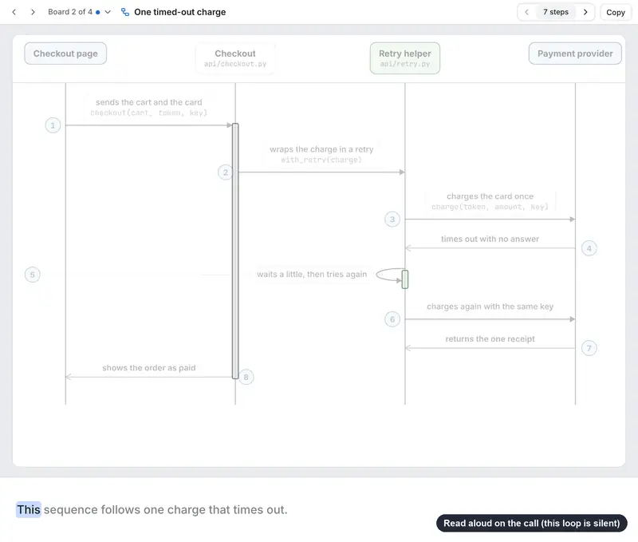

`/stage` keeps one page of boards in front of you while Claude works: code with
lines lit, a deck, a table, a sequence, a running app. Each `stage show` adds a
board in seconds. Save a file and its board reloads, with a dot that says it
changed.

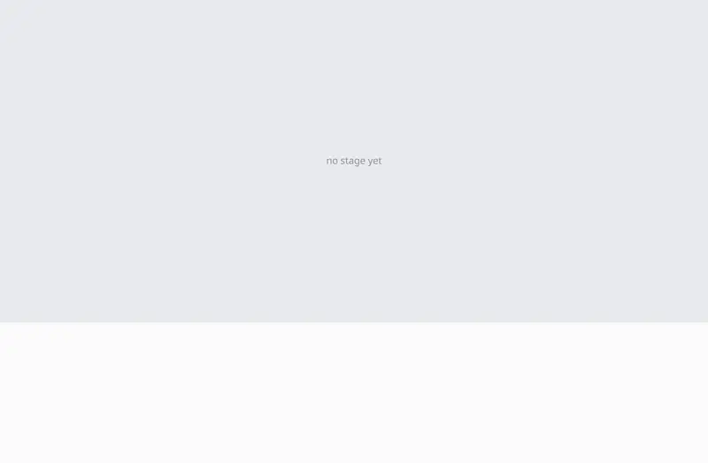

## Spotlight

`/spotlight` explains a user interface part by part, as one self-contained
HTML page with no tooling to install. The real screen sits on the left with
everything dimmed except the part in focus; a dashed line runs to the claim
about it. Arrow keys walk the parts, and a narrow window stacks the screen
above the text.

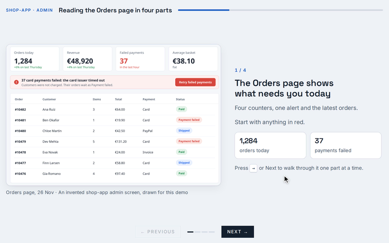

## Canvas

`/canvas` shows a set of screenshots — every screen of an app, desktop and
phone, every state of a UI — as one canvas that pans and zooms. *Fit all* shows
everything; *Changed only* keeps the boards that changed since last time.
Comments pin on the shots and reach Claude through the daemon.

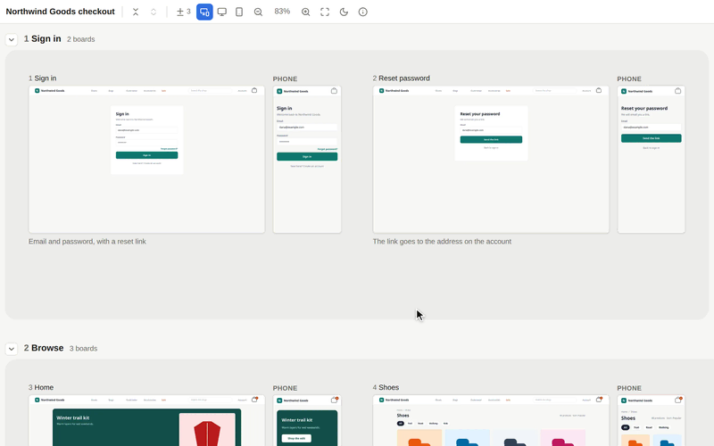

## Structure

`/dataflow` maps one feature's path through a codebase. In the field view,
hover a field and its route lights across every record while the rest dims.
The class view, where every node opens in the editor, needs a live session and
is not recorded.

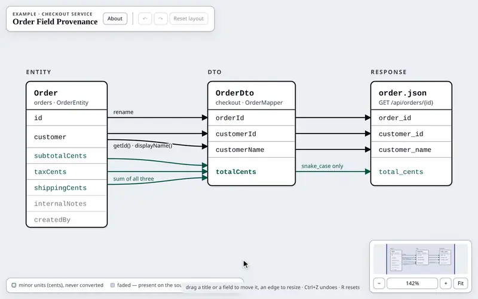

`/specimen` shows one Java object filled with real values, with every null
marked in red. Ask about a field and the question reaches the session.

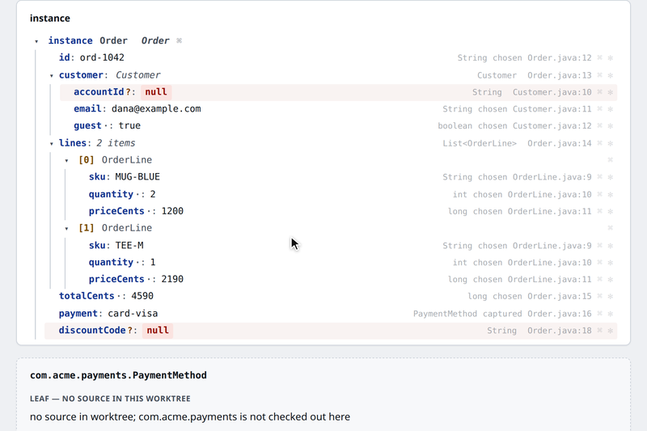

`/app-map` draws a map of the whole application: its parts, how they connect
and who owns each. In IntelliJ, ⌘⇧M shows it over the editor with the open
file's part lit. The clip shows the same map in a browser with a part lit by
hand.

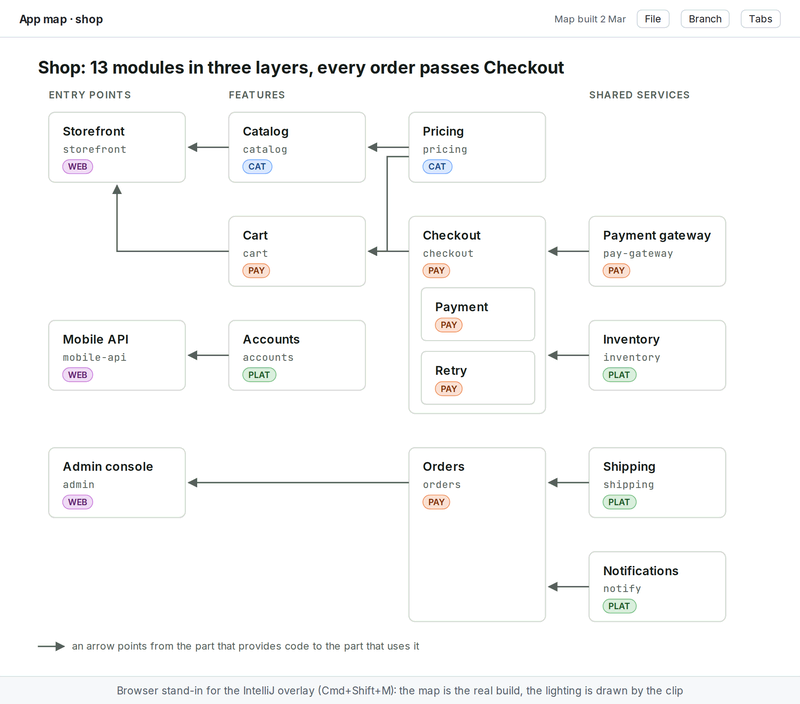

## People and fleets

The `fleet` plugin joins Claude Code sessions so they can tell, ask and answer
each other with no polling. Its page shows every session on every machine, a
search by meaning, the members, a backlog with dependencies, and the tools each
machine has, on desktop and phone.

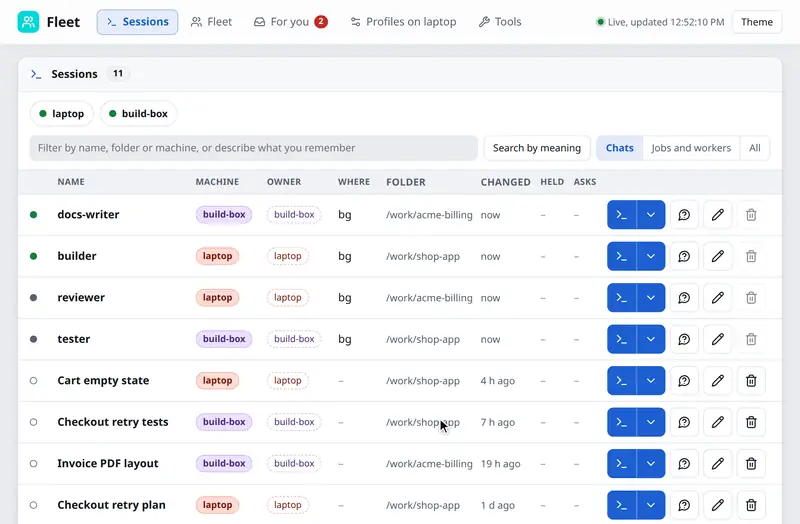

`/journey <canvas>` attaches a session to an app's journey canvas. Pin comments
on its screens, press Send, and one batch waits for the session.

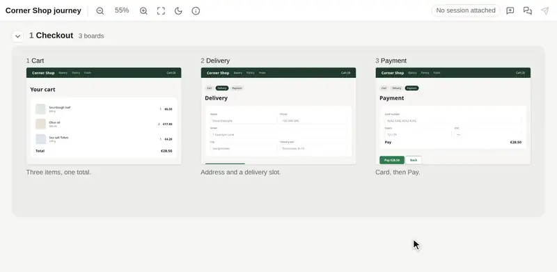

`/draw` gives one drawing pad at a link that never changes, for sketching on a
tablet while you talk to a session. Each Update sends the drawing to it.

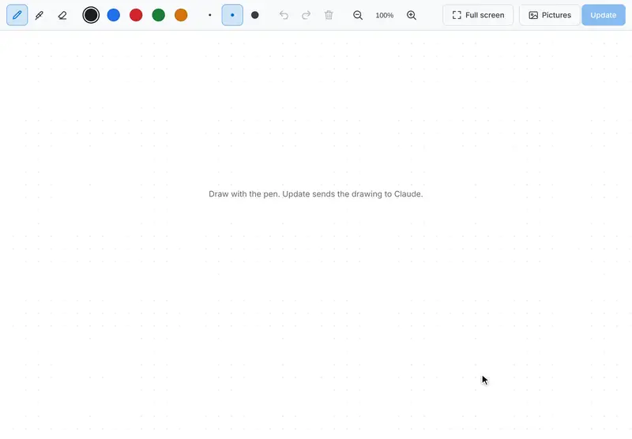

## IDE

`/show-diff` opens every changed file of a branch, or any other pair, as one
scrollable diff in VS Code. Ask a question on a line and Claude's answer appears
under it.

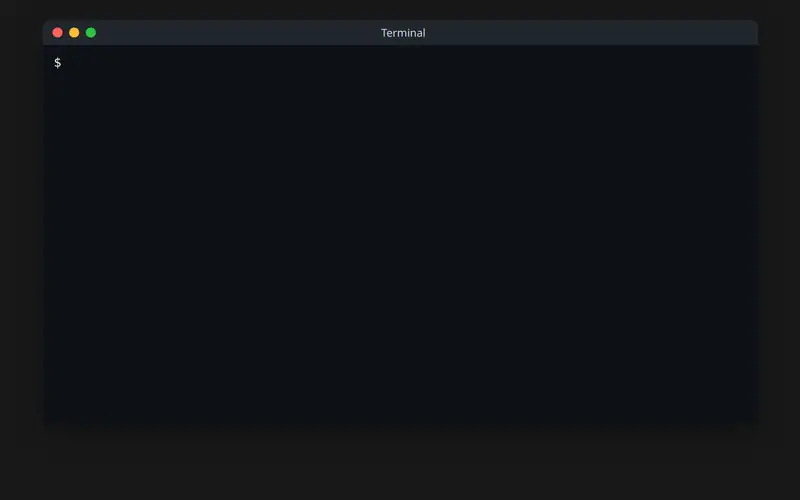

The IntelliJ half has three skills. In the clip, a walkthrough step gets a
question and its answer, a question on a line of a PR's diff is answered under
the line, ⌥D walks one file back through its changes, and ⌘⇧M shows where the
file sits in the app.

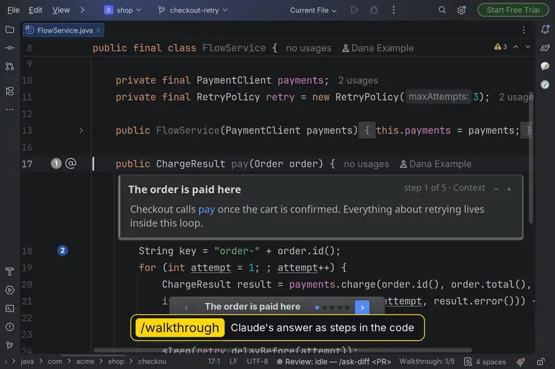

- **`/ask-diff`** — click a line of a GitHub PR diff in IntelliJ and ask; the
  answer threads under the line.
- **`/walkthrough`** — Claude answers a codebase question as ordered steps, and
  the plugin walks you through them in the editor: ⌥N next, ⌥P back, ⌥A to ask
  about a step, ⌥X to close.
- **`/pr-diff`** — opens a GitHub PR's diff in the IntelliJ window whose
  checkout has the PR's branch. It is not in the clip: it needs a GitHub
  sign-in and a real PR.

## How it works

There is no per-response server. Every push renders the response as
addressable items and PATCHes them onto the **webcompanion daemon** — a
separately-installed, always-on service (a different repository,
[webcompanion](https://github.com/petmakris/webcompanion)) shared by every
migrated skill and the IDE plugin. Your comment becomes an event on that
daemon; `webcompanion watch` wakes Claude, Claude rewrites the block and
PATCHes it back, and the page picks up the change over its SSE connection.
Sessions persist in the daemon's own storage, so you can close the tab and
come back to a document with its comment history intact.

The daemon's address and write token live in `~/.claude/webcompanion/config.json`.
Run `/annotate-doctor` to check whether the daemon is installed and running,
or to have it install and start it for you.

Voice dictation needs a secure browser context, so it works on `localhost` and
not over a LAN hostname.

## Related

Twelve of the seventeen skills (`annotate`, `ask_diff`, `canvas`, `dataflow`, `deck`,
`draw`, `journey`, `show-diff`, `specimen`, `stage`, `talk`, `walkthrough`) push to the same
**webcompanion daemon** — `slides`, `spotlight` and `app_map` never do, `annotate-doctor`
only checks it and `pr-diff` hands off to the IDE plugin. It is one always-on process
per machine, installed separately (`pipx install webcompanion`) from its own
repository, not something this repository runs. Run `/annotate-doctor` to
check whether it's installed and running, or to have it install and start it
for you.

This repository runs no server of its own. Every skill reaches the daemon
through `skills/_shared/webcompanion_client.py`; `skills/_shared/README.md`
says what else is shared and the rule for what may live there.

The older, similarly-named repositories
[web-companion](https://github.com/petmakris/web-companion) (hyphenated) and
[claude-ide-review](https://github.com/petmakris/claude-ide-review) are superseded
by this repository and kept for their history only — they predate `webcompanion`
above and are unrelated to it.

## License

MIT
